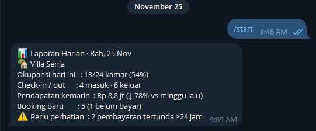

# resort-ops-automation

An automated daily report for a resort: every morning at 07:00 WIB (UTC+7), an operations summary arrives in the manager's Telegram without anyone putting it together by hand.

It is a small TypeScript job that runs on GitHub Actions. The data is dummy, and the data source is a swappable adapter.

## Sample message



The report itself is written in Indonesian. All data in this repo is **dummy** (a fictional property, "Villa Senja"). There is no real guest data and there are no real credentials.

## How it works

```
GitHub Actions (cron) → DataSource → computeReport → formatReport → Telegram
```

- Free: no server, it runs on GitHub Actions.
- Without a token, the script runs in dry-run mode and prints the report to the console.

## Try it yourself

1. **Fork** this repo.
2. Create a Telegram bot with [@BotFather](https://t.me/BotFather) and keep its token. Send one message to the bot, then find your `chat_id`.
3. In your fork, open **Settings → Secrets and variables → Actions** and add:
   - `TELEGRAM_BOT_TOKEN`
   - `TELEGRAM_CHAT_ID`
4. Open **Actions → Daily report → Run workflow** to test it by hand. After that it runs automatically every morning.

Never put the token in code or commit a `.env` file.

> Note: GitHub disables scheduled workflows in repos that have been inactive for 60 days. Turn it back on from the Actions tab if that happens. Scheduled runs can also start a few minutes late.

## Run it locally

```bash
npm install
npm test
npm start          # dry-run, prints to the console
```

To send for real from your own machine, copy `.env.example`, fill in the values, and run with those variables set in your environment.

## Connect real data

Data is read through the `DataSource` interface in [`src/types.ts`](src/types.ts):

```ts
interface DataSource {
  getRoomCount(): Promise<number>;
  getBookings(): Promise<Booking[]>;
}
```

Write a new class that implements that interface (for example, one that calls your booking backend's API), then use it in `src/main.ts` in place of `DummyDataSource`. Nothing else needs to change.

## License

MIT. See [LICENSE](LICENSE).
